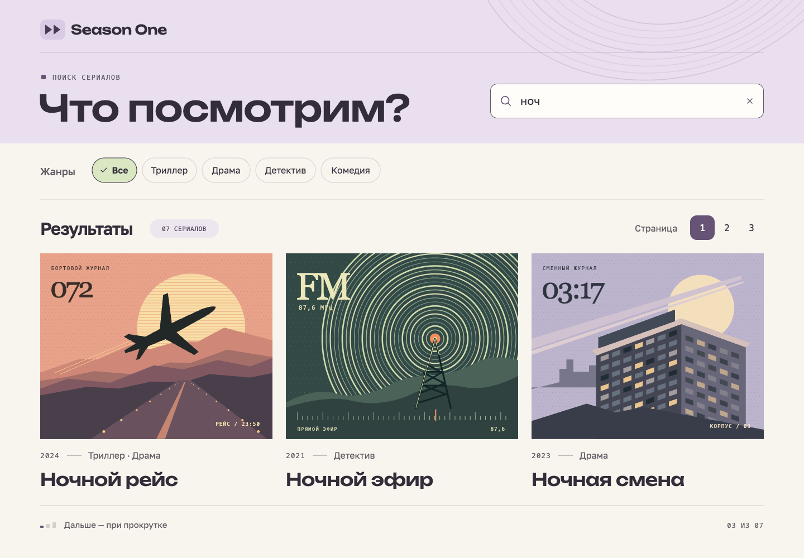

# Season One · дизайн TV Shows Explorer

[Скачать альбом в PDF](series-search.pdf) · [Компоненты и их состояния](components.md) · [Токены в JSON](tokens.json)

**Season One** — утверждённое название приложения для обеих локалей. [Логотип в светлой и тёмной темах](screens/10-names.svg).

## Тема, восстановление и уведомления

| Материал             | Макеты                                                                                                                                                                                                                                                           |
| -------------------- | ---------------------------------------------------------------------------------------------------------------------------------------------------------------------------------------------------------------------------------------------------------------- |
| Тёмная тема          | [Настольный экран](screens/11-dark-results.svg), [телефон](screens/12-dark-mobile.svg), [старт](screens/13-dark-start.svg), [фильтр](screens/14-dark-filter.svg), [состояния поиска](screens/15-dark-feedback.svg), [компоненты](screens/16-dark-components.svg) |
| Общая ошибка рендера | [Светлый экран](screens/17-recovery.svg), [тёмный экран](screens/18-recovery-dark.svg), [мобильный светлый](screens/19-recovery-mobile.svg), [мобильный тёмный](screens/19-recovery-mobile-dark.svg), [сценарий восстановления](screens/23-recovery-sizes.svg)   |
| Уведомления          | [Четыре вида в обеих темах](screens/20-notifications.svg), [положение над экраном](screens/21-notification-placement.svg)                                                                                                                                        |
| Иконка               | [Макет и размеры](screens/22-app-icon.svg), [SVG](icons/app-icon.svg), [favicon.ico](icons/favicon.ico), [PNG 512](icons/icon-512.png)                                                                                                                           |

Для библиотеки подготовлены [правила поведения и тексты RU/EN](system-components.md), [тёмные цвета](dark-colors.json) и [токены уведомлений](notification-tokens.json).

## Экраны

Каждый SVG — самостоятельный редактируемый макет. Его можно открыть в браузере или перетащить в редактор векторной графики. Постеры нарисованы в векторе, текст остаётся текстом. Для ссылки на конкретное состояние используйте файл из таблицы.

| Макет                                                         | Что сверять при разработке                                                                           |
| ------------------------------------------------------------- | ---------------------------------------------------------------------------------------------------- |
| [Старт · 1440 px](screens/02-initial.svg)                     | Только пустое поле. Нет карточек, фильтров и запроса при открытии.                                   |
| [Поиск · 1440 px](screens/01-results.svg)                     | Запрос «ноч», три карточки из семи, все четыре жанра, страница 1.                                    |
| [Выбран детектив](screens/03-filtered.svg)                    | Остаются две карточки, в том числе одна со второй страницы исходной выдачи. «Все» сбрасывает фильтр. |
| [Поиск · 390 px](screens/04-mobile.svg)                       | Теги переносятся на вторую строку, номера остаются над результатами, постеры становятся миниатюрами. |
| [Три мобильных состояния рядом](screens/05-mobile-states.svg) | Старт → ввод → фильтр.                                                                               |
| [Переходы между страницами](screens/06-paging.svg)            | Последовательность 3 + 3 + 1. Номер страницы переносит к группе; прокрутка дополняет список.         |
| [Загрузка, пустая выдача и ошибка](screens/07-feedback.svg)   | Первая загрузка, отсутствие совпадений, повтор запроса и подгрузка следующей группы.                 |
| [Библиотека компонентов](screens/08-components.svg)           | Образцы поиска, тегов, навигации, статусов и карточек с запасным изображением.                       |
| [Цвета, шрифты и сетка](screens/09-foundations.svg)           | Визуальные значения для библиотеки.                                                                  |

В SVG встроены шрифты для просмотра без сети. Для редактирования текстовых слоёв установите [Unbounded](fonts/Unbounded.ttf) и [Golos Text](fonts/GolosText.ttf). Оригиналы: [Unbounded в Google Fonts](https://github.com/google/fonts/tree/main/ofl/unbounded) и [Golos Text в Google Fonts](https://github.com/google/fonts/tree/main/ofl/golostext). Рядом с файлами сохранены лицензии [Unbounded](fonts/OFL-Unbounded.txt) и [Golos Text](fonts/OFL-GolosText.txt).

Названия сериалов, годы и постеры — иллюстративные данные макета. Они позволяют проверить сценарии независимо от поставщика API. Это статические макеты: последовательности действий описаны в [правилах компонентов](components.md).

## Контрольный сценарий

1. Открыть приложение: виден только поиск. Ввести «ноч»: появляется первая тройка из семи.
2. Выбрать «Комедия»: виден только «Ночной сеанс», исходно седьмой. Теги берутся из всей выдачи и не исчезают после выбора. Нумерация скрыта.
3. Нажать «Все»: видна первая тройка. Прокрутить вниз: к ней добавляются № 4–6, затем № 7. У конца списка больше нет загрузки.
4. Выбрать номер 1: начало первой тройки снова в поле зрения. Очистить запрос: вернуться к одному полю.
